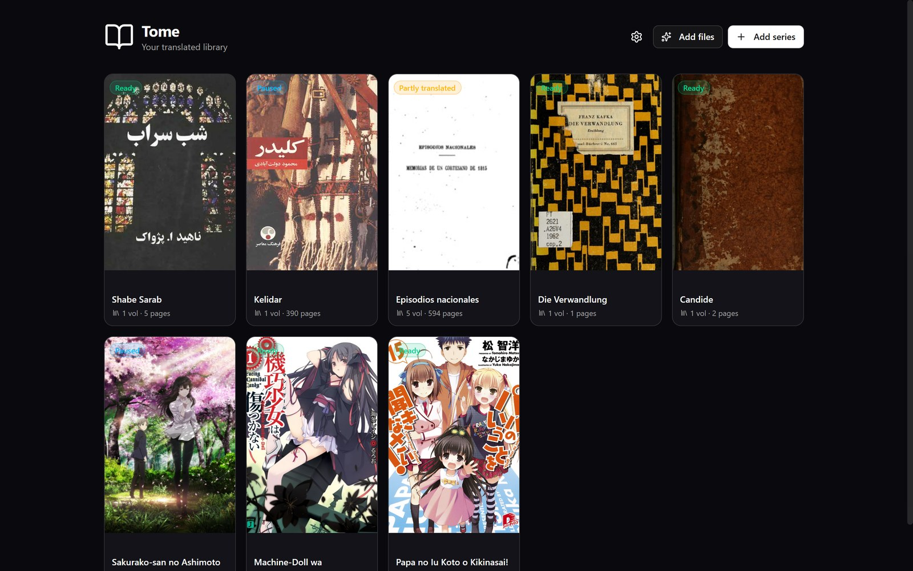
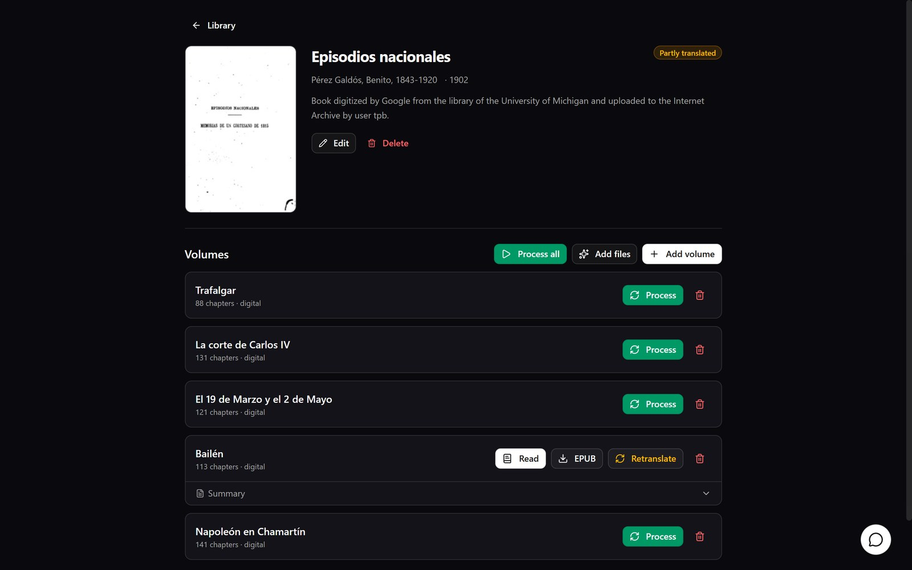
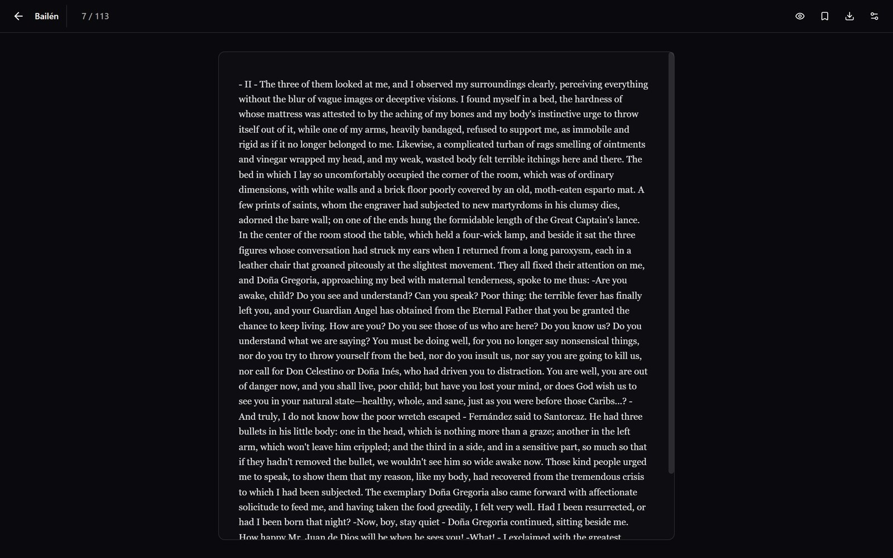
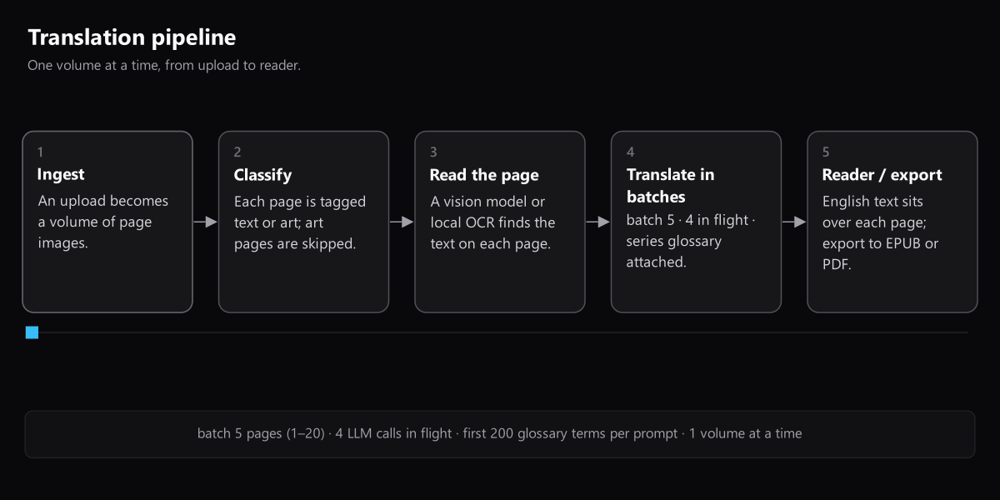

<div align="center">


# Tome

**Series-aware translation for books.**

A translator reads a series, not a page. Tome is built the same way.

[](LICENSE)
[](https://www.python.org/)
[](https://fastapi.tiangolo.com/)
[](https://react.dev/)
[](CONTRIBUTING.md#tests)
[](#contributing)
[](https://github.com/computator1200/tome/stargazers)
[](https://github.com/computator1200/tome/releases)
[](https://github.com/computator1200/tome/actions/workflows/ci.yml)


</div>

---

## Why

Translating a book page is a solved problem. Translating a *series* is not.

A character is named in volume 1, nicknamed in volume 3, referred to by title in
volume 5, and by volume 7 a naive page-by-page translator has given them four
different names in the target language. The reader notices. The story breaks.

Tome treats the series as the unit of work: a **series → volume → page** model,
an object store for the pages themselves, and a memory layer that is meant to
carry a cast of characters across the whole run.

<div align="center">

</div>

<div align="center">

</div>

## What's here

- **📚 Library** - series, volumes, reading progress, per-series settings.
- **📥 Ingest** - drop an archive of scans or a digital book; the format is read
  from magic bytes, not the file extension.
- **🔍 Translate** - a **vision** path (page image in, translated regions out) and
  a **local OCR** path that extracts text first.
- **🗂 Metadata** - title search across keyless book catalogues in any language.
- **📖 Reader** - the translation alongside the original, page by page.
- **🗃 Whole series, one click** - `Process all` queues every unfinished volume in
  reading order.
- **🤖 Librarian** - an agent with 26 tools over the library that organises
  uploads, links metadata and repairs what went wrong instead of describing it.
- **📤 Export** - visual PDF and EPUB.

<div align="center">

</div>

## How it works

<div align="center">

</div>

Five stages from upload to reader: ingest, classify, read the page, translate in
batches with the series glossary attached, then read or export. Alongside the
translation, the model extracts a per-series graph of characters, aliases and
relations, and each volume's prompt gets only what was established by that
volume, so volume 3 never sees a volume-12 spoiler.

Any OpenAI-compatible endpoint works. Tome is built and tested against
**Gemma 4** (`gemma4:31b`, [model card](https://ai.google.dev/gemma/docs/core/model_card_4),
[Apache 2.0](https://ai.google.dev/gemma/apache_2)) through Ollama Cloud.

## Quickstart

```bash
git clone https://github.com/computator1200/tome && cd tome
cp .env.example .env            # endpoint, key, model
python -m venv venv && ./venv/bin/pip install -r backend/requirements.txt
cd frontend && npm install && npm run build && cd ..

cd backend && ../venv/bin/uvicorn main:app --host 127.0.0.1 --port 8077
```

Open <http://127.0.0.1:8077> and add a series. Running under a subpath, the
local-OCR engine and the dev loop are covered in [docs/ONBOARDING.md](docs/ONBOARDING.md#dev-loop).

## Status

Works end to end: ingest a scan archive or a digital book, classify, OCR or
vision, translate, read, export, and resume a stopped volume from the next
unfinished page. Not done yet: per-page memory, region bounding boxes (the reader
is a text panel, not an overlay) and quality gates. The full list is in
[docs/ROADMAP.md](docs/ROADMAP.md#open).

## Docs

| | |
|---|---|
| [Architecture](docs/ARCHITECTURE.md) | layout, the pipeline stage by stage, the agent loop, shipped vs designed |
| [Graph memory](docs/GRAPH-MEMORY.md) | what the memory code does today, with diagrams |
| [Memory design](docs/MEMORY.md) | why the graph exists, how facts get in and out, its limits |
| [Models and agent skill](docs/MODELS.md) | Gemma 4, swapping models, the portable [librarian skill](skills/tome-librarian/SKILL.md) |
| [Deployment](docs/DEPLOYMENT.md) | systemd, a reverse proxy, the two subpath knobs |
| [Roadmap](docs/ROADMAP.md) | what shipped and what is open |
| [Onboarding](docs/ONBOARDING.md) | where to start reading, the dev loop, traps |
| [Changelog](CHANGELOG.md) | what each release changed |

The same pages are on the [wiki](https://github.com/computator1200/tome/wiki).

## Contributing

See [CONTRIBUTING.md](CONTRIBUTING.md) for setup, conventions, tests and the rules
that have already cost an afternoon. If you are touching the translation
pipeline, keep the rule that a bad page never takes down a volume.

## License

MIT. See [LICENSE](LICENSE).

---

<div align="center">

<a href="https://star-history.com/#computator1200/tome&Date">
  
</a>

</div>

