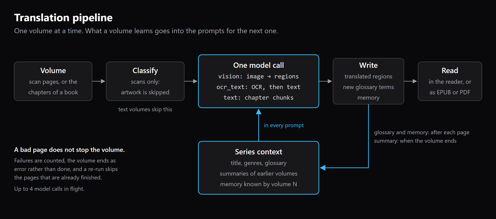
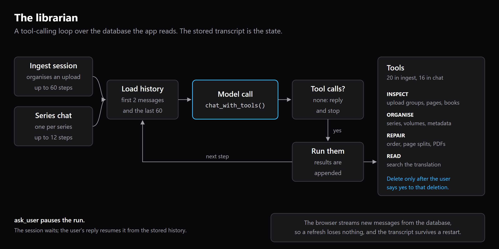

# Architecture

How the pieces fit, stage by stage. Every number below was read from the code
at the cited `file:line` (main as of 2026-10-24). If you change one of those
lines, update this file, and the diagram if it shows the number, in the same
commit. The diagrams are `docs/images/pipeline.svg` and `librarian.svg`, with
PNG renders beside them for GitHub.

---

## Overview

```
frontend/          React + TypeScript + Vite + shadcn/ui
backend/           FastAPI + SQLAlchemy (async) + SQLite
  routers/         HTTP surface
  services/        pipeline · llm · ingest · documents · agent · metadata
  storage_backend/ object store (local now, S3-shaped interface)
```

A **series** holds **volumes**; a volume holds **pages**. A page is either an
image (a scan) or a text block (a digital chapter). Translation runs per page,
but the context handed to the model is per series. After a volume completes,
its summary is fed forward as context for the next one. The `jobs` table is the
single source of truth for progress, so a refresh or a restart does not lose
the state.

Storage:

- `backend/storage_backend/` is the only place allowed to touch a page file.
  Keys look like `volumes/<volume_id>/pages/0000.jpg`; database rows point at
  them, so keys are never renamed.
- Local disk today, behind an S3-shaped interface (`STORAGE_BACKEND=local`; s3
  is not implemented).
- SQLite for the index (`DATABASE_URL`), images by key. The original digital
  source (EPUB) is kept as well, so a translated EPUB can be repacked from it.

Three decisions that everything else leans on:

1. **Pages are objects, not database blobs.** A page image is stored by key; the
   database holds the index. Swapping local disk for S3 is a backend, not a
   migration.
2. **A translated page is regions, not a string.** Every region has text and
   `x`/`y`/`width`/`height` columns, which is what the reader, the PDF re-layout
   and page-level diffing read. Nothing fills the coordinates yet (see the table
   at the end), so the reader is a text panel, not an overlay.
3. **One OpenAI-compatible endpoint.** `services/llm.py` talks to anything that
   speaks Chat Completions, so the app runs against a hosted model or a local
   runner without code changes. See [MODELS.md](MODELS.md).

---

## 1. Translation pipeline



A single worker task drains an in-process `asyncio.Queue`
([worker.py](../backend/services/worker.py) `enqueue` :25, `_run` :30), so
only one volume is processed at a time. Each volume goes through
`process_volume()` ([pipeline.py](../backend/services/pipeline.py) :166).

The diagram shows five boxes; the table below carries the detail behind
them. Box 1 is row 1, box 2 is row 2, box 3 ("Read the page") covers the OCR
half of rows 3a and 3b, box 4 ("Translate in batches") covers row 4 and the
batching in 3b, and box 5 is rows 5–7. Two simplifications in the picture:
the `vision` engine reads and translates a page in one call, so it never
batches; and `kind = text` volumes skip boxes 2 and 3 (row 3c).

| # | Stage | File · function | What to know |
|---|---|---|---|
| 1 | Ingest | [routers/volumes.py](../backend/routers/volumes.py) `create_volume` :32; [ingest.py](../backend/services/ingest.py) `extract_group_to_volume` :452, `create_text_volume` :401 | Page images go to the object store under `volumes/<id>/pages/0000.ext` (volumes.py:80); the DB holds only the key. |
| 2 | Classify | [page_classifier.py](../backend/services/page_classifier.py) `classify_page` :16, called from pipeline.py:201-209 | OpenCV pixel statistics. Runs on every page, sequentially, on every run. Only `text` and `mixed` pages continue (pipeline.py:36, :211). |
| 3a | vision engine | pipeline.py `_run_vision` :324 → [llm.py](../backend/services/llm.py) `vision_ocr_translate` :377 | One call per page: image and glossary in, regions out. |
| 3b | ocr_text engine | pipeline.py `_run_ocr_text` :366 | OCR first: `llm.ocr_page_vision` :351 when `OCR_BACKEND=vision` (the default, config.py:23), or `services/ocr.py` `ocr_page` sequentially for `manga_ocr`. Then `translate_text` on batches of `batch_size` pages. |
| 3c | text volumes | pipeline.py `_run_text_volume` :260 | Digital books skip stages 2 and OCR. Blocks are chunked per chapter. |
| 4 | LLM call | llm.py `_context_block` :68, `_chat` :173, `translate_text` :261 | The prompt carries title, author, genres, synopsis `[:1200]`, earlier volumes' summaries `[:4000]`, and the glossary as `source -> target` lines. |
| 5 | Write | pipeline.py `_replace_regions` :478, `_merge_new_terms` :113 | Regions are replaced per page. New terms returned by the model go into `glossary_terms`, deduplicated by source string. All DB writes go through one `asyncio.Lock` because the session is shared. |
| 6 | Summarize | pipeline.py `_summarize_volume` :138 → llm.py `summarize` :325 | Its output becomes `Volume.summary`, which is the context for later volumes (pipeline.py:128). |
| 7 | Read / export | [routers/export.py](../backend/routers/export.py) `export.epub` :45, `export.pdf` :102; progress SSE [routers/process.py](../backend/routers/process.py) :90 | Progress is the `Job` row, polled every 0.5 s. |

### Numbers

| Value | Where |
|---|---|
| `OPENAI_CONCURRENCY` default **4** | [config.py](../backend/config.py):20; runtime fallback provider.py:49 |
| Concurrency is per stage: one `asyncio.Semaphore(_concurrency())` per stage | pipeline.py:56, :282, :332, :386, :432 |
| `batch_size` default **5**, clamped to **1–20** | db/models.py:129; routers/volumes.py:37; pipeline.py:427 |
| Text chunks: at most **40** blocks; a chunk is closed once it is **over 4000** characters, so one chunk can run past 4000 | pipeline.py:256-257, :271 |
| Glossary in the prompt: first **200** terms | llm.py:65, :91 |
| `_chat` retries: **3** attempts, sleeping 1 s then 2 s; 400/401/403/404 are not retried | llm.py:170-200 |
| LLM timeout default **180 s** | config.py:18 |
| Temperature **0.3** (translation), **0.2** (agent) | llm.py:150, :219 |

**Image volumes are chunked by page count, not by a character budget.** The
character budget (4000) exists only for `kind = text` volumes.

### Isolation (what one failure takes down)

| Path | Unit | Where |
|---|---|---|
| vision | one page | `LLMError` caught per page, pipeline.py:343-350; siblings keep running thanks to `gather(..., return_exceptions=True)` :362 |
| ocr_text translate | one **batch** (up to `batch_size` pages) | pipeline.py:449-455; failed count += `len(batch)` |
| text volumes | one chunk | pipeline.py:299-306 |
| volume outcome | `failed > 0` → volume `error` with a count | pipeline.py:224-230 |
| resume | finished pages are skipped | `_is_translated` :157, `_has_ocr` :162 |

Gaps:

- Vision-OCR failure sets the page's regions to `[]` and is **not counted** as
  failed (pipeline.py:396-398). The page drops out of `pages_with_text` (:425),
  so the volume can finish `done` with untranslated pages.
- `manga_ocr` has no try/except around `ocr_page` (pipeline.py:415), so one
  bad page aborts the whole volume through the outer handler (:243).
- Any exception other than `LLMError` inside a task (for example `store.get`
  failing) is swallowed by `gather(return_exceptions=True)` and never counted
  (pipeline.py:320, :362, :409, :474).

---

## 2. Agent surface



| Piece | File · function |
|---|---|
| Session rows | [db/models.py](../backend/db/models.py) `AgentSession` :209, `AgentMessage` :235 (ordered by `seq`) |
| Loop | [agent.py](../backend/services/agent.py) `_run` :183: load history (first 2 + last 60 messages, :31-32, :150), call `llm.chat_with_tools` (llm.py:203), append, run tools, repeat |
| Step caps | ingest **60**, chat **12** (agent.py:30) |
| Ask / suspend | `ask_user` raises `AskUser` → status `waiting_user` (agent.py:222-240); the user's reply respawns the run from history (`post_user_message` :381) |
| Restart | running sessions are marked `error`, never auto-resumed (`recover_orphans` :405) |
| Tools | [agent_tools.py](../backend/services/agent_tools.py) registry :465, `TOOLSETS` :565, `run_tool` :586; results truncated to **8000** chars (:39, :59) |
| HTTP | [routers/agent.py](../backend/routers/agent.py): `POST /api/ingest` :49, `GET …/stream` :125, `POST …/message` :161, `GET /api/series/{id}/chat` :197 |
| Panel | [AgentChat.tsx](../frontend/src/components/AgentChat.tsx), [ImportSession.tsx](../frontend/src/components/ImportSession.tsx), `createAgentStream` in [api.ts](../frontend/src/lib/api.ts):251 |

**SSE and `${BASE}`.** The stream endpoint polls the DB every 0.7 s and emits
one `message` event per new `AgentMessage` with `seq > after`, plus a `status`
event whenever the session changes. It closes once the session stops
`running` (routers/agent.py:125-158). On the client, axios gets
`baseURL: ${BASE}/api` (api.ts:15-19), but `EventSource` does not go
through axios. So the URL is built by hand as
`${BASE}/api/agent/sessions/${id}/stream?after=${seq}` (api.ts:258). `BASE`
is Vite's `BASE_URL` (from `VITE_BASE`, vite.config.ts:16), and the server
mounts every router under `URL_PREFIX` (main.py:47-54). Drop the prefix and
the feed works on `/` but stays silent under a subpath.

**Can:** create series and volumes and queue translation (ingest only);
search translated text with FTS5, falling back to LIKE (agent_tools.py:390);
read a page, capped at 6000 chars (:421); read summaries and the glossary;
overwrite series metadata; pause on a question.

**Cannot:** delete anything; write the glossary or any region (no tool
touches `GlossaryTerm` or `Region` for writing); queue translation from a
chat session; query graph memory (no agent tool reads `memory_*`; the
graph is only reachable through `GET /api/series/{id}/memory`); stream
tokens (whole messages only).

---

## 3. Series graph memory

The code is in [services/memory.py](../backend/services/memory.py).
[GRAPH-MEMORY.md](GRAPH-MEMORY.md) walks through it with diagrams: entities,
the aliases that fold into them, typed edges that each carry the volume that
established them, and the rule that a volume 3 prompt never sees a volume 12
edge.

| What | Where |
|---|---|
| Tables `memory_entities`, `memory_aliases`, `memory_edges` | models.py:273, :291, :307 |
| Write: model returns `memory` in the translation JSON | llm.py:299-306, :419 |
| Write: `_merge_new_terms` → `record_extraction`, errors swallowed | pipeline.py:113-144; memory.py:254 |
| Resolution: normalise → exact alias → difflib ≥ 0.90 → CJK prefix/suffix | memory.py:62, :169, :177-217 |
| Relations: 19 canonical verbs, kind-checked | memory.py:113, :121, :144 |
| Read: `build_context(volume_order)` filters `established_volume <= volume_order` | memory.py:323-365 |
| Prompt block "What is known by volume N" | memory.py:368; pipeline.py:222-225; llm.py:89-90 |
| API `GET /api/series/{id}/memory?volume=N` | routers/series.py:204 |
| Tests (13, all passing; 40 in the suite) | tests/test_memory.py |

The flat glossary still runs alongside the graph (pipeline.py:92,
llm.py:68). The memory block is built once per volume run and is the same
for every page.

---

## What is real vs designed

| Capability | Real | Designed | Evidence |
|---|---|---|---|
| Classify scans | ✅ | | page_classifier.py:16 |
| Vision engine (1 call/page) | ✅ | | pipeline.py:324 |
| ocr_text engine, batched | ✅ | | pipeline.py:366, :427 |
| Text-volume chunking | ✅ | | pipeline.py:256-277 |
| Per-page isolation (vision) | ✅ | | pipeline.py:343 |
| Per-page isolation (ocr_text) | ⚠️ per batch | | pipeline.py:449 |
| Region bounding boxes | ❌ always 0 | | llm.py:381 vs :420-426; pipeline.py:486 |
| Flat glossary, grows from model output | ✅ | | models.py:254, pipeline.py:113 |
| Glossary capped at 200 terms | ✅ | | llm.py:65 |
| Previous-volume summaries as context | ✅ | | pipeline.py:128, llm.py:86 |
| Agent loop, ask_user, two toolsets | ✅ | | agent.py:183, agent_tools.py:565 |
| Agent SSE feed with `${BASE}` | ✅ | | api.ts:258 |
| `memory_entities` (series, kind, canonical, first_volume) | ✅ | | models.py:273 |
| `memory_aliases` (alias, indexed norm, volume, script) | ✅ | | models.py:291; memory.py:220 |
| `memory_edges` (relation, established_volume, page_id) | ✅ | | models.py:307; memory.py:254 |
| Volume scoping: only edges with `established_volume <= N` reach volume N's prompt | ✅ | | memory.py:343-344; pipeline.py:222-225 |
| Edges cite the page that established them | ⚠️ column exists, always `None` | | pipeline.py:355, :395, :533, :554 |
| Per-page memory retrieval | | 📐 | block is per volume (pipeline.py:224) |
| Series-wide `Process all` (queues unfinished, skips done) | ✅ | | routers/process.py `process_series` |
| `reorder_volumes`, `repair_volume_pages` repair tools | ✅ | | services/maintenance.py |
| `convert_pdf_to_scans` for PDFs with no Unicode text layer | ✅ | | services/ingest.py `render_pdf_group` |
| Glyph-soup detector (letter ratio below 0.5) | ✅ | | documents.py `_looks_like_glyph_soup` |
| Technical tool output collapsed by default in the chat | ✅ | | components/AgentChat.tsx |
| Page committed before the memory write | ✅ | | pipeline.py, all four paths |
| `check_translation` verifier | | 📐 | design only, not built |

## Where the docs and the code disagree

1. **Isolation is weaker than per page.** For ocr_text it is per batch,
   up to 20 pages (pipeline.py:449-455). Vision-OCR failures are not counted
   at all (:396). A `manga_ocr` failure takes down the volume (:415).
2. **The `vision_ocr_translate` docstring (llm.py:381) promises
   `x,y,width,height`.** The prompt never asks for coordinates (:395-405) and
   the parser never stores them (:420-426).
3. **The glossary cap drops terms arbitrarily.** `Series.glossary` has no
   `order_by` (models.py:111), so "the first 200" is whatever order the DB
   returns. Past 200 terms, names silently stop reaching the prompt, even
   names that appear on the page.
4. **The flat glossary has no spoiler horizon.** The graph and the
   summaries are both scoped to the volume (memory.py:343-344;
   pipeline.py:132). The flat glossary is not (:92). Terms learned in volume
   12 are still injected when volume 3 is re-run.
5. **agent_tools.py:4-5 says the chat agent gets "read-only lookup tools".**
   Its toolset includes `update_series` and `link_series_metadata`, which
   overwrite series metadata (:125, :194, :565-575).
6. **"Never call enqueue_processing without asking" is a prompt rule only**
   (agent.py:79-80). `_enqueue_processing` (agent_tools.py:307) does not check it.
7. **The text-volume failure message says "page(s) failed"** but counts
   chunks (pipeline.py:228 vs :302).
8. **The translate and vision prompts list 17 of the 19 relation verbs.**
    `kills` and `betrays` are accepted by memory.py:116, but they are missing
    from the allowed list in llm.py:307-309 and :427-429.
