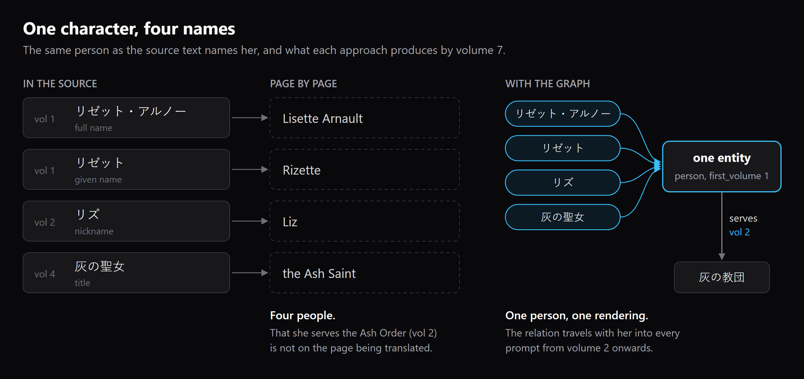
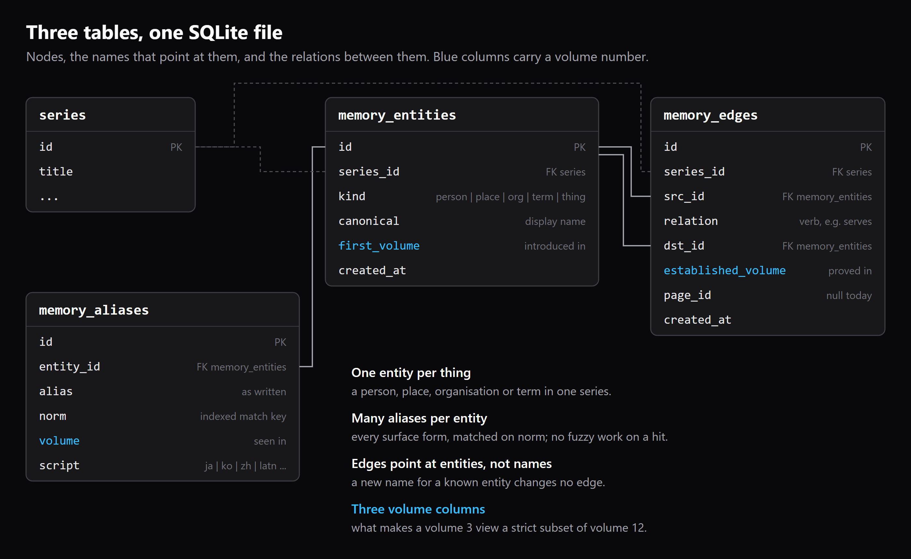
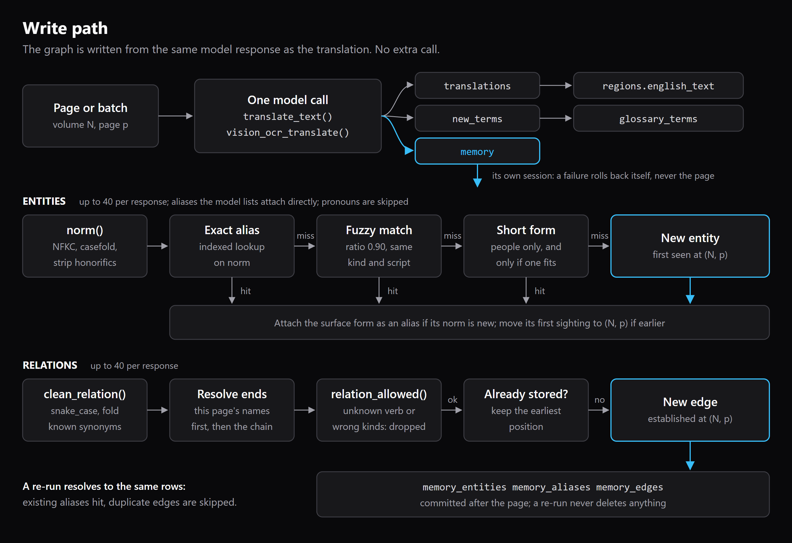
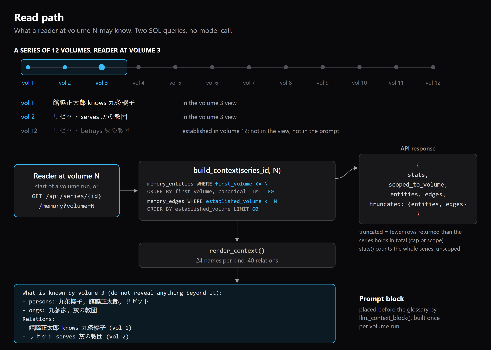

# Graph memory

Tome keeps a graph per series of who and what appears in the books, the names
each of them goes by, and how they relate. Each relation records the volume that
established it. The graph is written as a side effect of translation and read
back into every prompt, scoped to the volume being translated.

The code is `backend/services/memory.py`, the tables are in
`backend/db/models.py`, the write hook is `_merge_new_terms()` in
`backend/services/pipeline.py`, and the HTTP view is `series_memory()` in
`backend/routers/series.py`. This page describes what the code does today.

Across the library the graph currently holds 5,174 entities, 5,417 aliases and
572 typed relations. In an 18-volume series, a volume 1 prompt sees 22 entities
and 16 relations; the same series at volume 18 sees 80 and 60, the caps.
Separately, all 57,149 regions (9,207 translated) are indexed in a
SQLite FTS5 table (`region_fts`) for full-text search over the translated text.

## 1. The problem

A translator that works page by page sees one page and whatever context it is
handed. Take one character in a light-novel series:

- volume 1 introduces her as リゼット・アルノー, and the narration then calls
  her リゼット;
- in volume 2 her friends start calling her リズ, and the text establishes that
  she serves the order 灰の教団;
- from volume 4 she is mostly referred to by her title, 灰の聖女.



*Follow each row across. In the middle column every source name becomes its own
English name, so by volume 7 the reader has met four people. In the right column
the four names are aliases of one entity, and the `serves` edge from volume 2
goes with her.*

By volume 7 a page-by-page translator has produced Lisette Arnault, Rizette,
Liz and the Ash Saint. A flat glossary fixes the first two if someone adds the
right row, but it has no way to say that リズ and 灰の聖女 are the same person,
and no way to say that she serves 灰の教団. A volume 7 page that only says
"for that order's sake" is translated without knowing which order.

There is a second failure that a glossary cannot see at all: telling the
reader too much. If the model is given a fact from volume 12 while translating
volume 3, it can leak into the wording. The graph exists to carry what is known,
and only what is known by the volume in hand.

## 2. Three tables



*Look at the three blue columns: `first_volume`, `volume` and
`established_volume`. Every read is filtered on one of them. The solid lines are
the joins to `memory_entities.id`; the dashed lines are the per-series keys.*

| Table | One row is | Key columns |
|---|---|---|
| `memory_entities` | a person, place, organisation, term or thing in one series | `series_id`, `kind`, `canonical`, `first_volume` |
| `memory_aliases` | one surface form of an entity | `entity_id`, `alias`, `norm` (indexed), `volume`, `script` |
| `memory_edges` | one typed relation between two entities | `series_id`, `src_id`, `relation`, `dst_id`, `established_volume`, `page_id` |

Why three and not one:

- **Entities and aliases are separate** because the mapping is one to many.
  Four names point at one row. Lookups go through `memory_aliases.norm`, an
  indexed exact match, so the common case costs one query and no fuzzy work.
- **Edges are separate from entities** because a relation has its own facts: a
  type and the volume that proves it. Edges hold entity ids, not names, so a new
  alias for a known entity changes no edge.
- **Each table carries a volume.** That is what lets the read path return a
  strict subset of the graph for an earlier volume.

All three live in the same SQLite file as the rest of Tome. Deleting a series
cascades to its entities and edges, and deleting an entity cascades to its
aliases and edges. `page_id` exists on `memory_edges` but the pipeline passes
`None` today, so edges record the volume, not the page.

## 3. The write path



*Read the top row first: one model call returns three keys, and only `memory`
feeds the graph. Then read each lane left to right: an entity name stops at the
first step that finds a match, and a relation must pass the kind check before it
is stored.*

### When extraction happens

There is no separate extraction call. The translate prompts in
`backend/services/llm.py` (`translate_text()` and `vision_ocr_translate()`) ask
for a `memory` object in the same JSON response as the translation:

```json
"memory": {
  "entities": [{"name": "リゼット", "kind": "person", "aliases": ["リズ"]}],
  "relations": [{"src": "リゼット", "relation": "serves", "dst": "灰の教団"}]
}
```

After each page or batch, the pipeline calls `_merge_new_terms()`, which first
adds any `new_terms` to `glossary_terms` and then passes the `memory` object to
`memory.record_extraction()` with the volume's `order`. The graph therefore
costs no extra model calls. The call is wrapped in a `try`: on any error the
session is rolled back and the pipeline logs `memory extraction skipped`.
Memory never fails a translation.

`record_extraction()` reads at most 40 entities, 6 aliases per entity and 40
relations from one response.

### Resolving a name

`resolve_or_create()` turns a surface form into an entity, in this order:

1. **Normalise.** `norm()` applies NFKC, casefolds, strips trailing honorifics
   (さん, 様, 君, ちゃん, 先生, 씨, 님, -san, -sama and others) and edge
   punctuation, and collapses whitespace. Names on the stop list (僕, 私, 俺,
   I, he, she and similar) are not entities and return nothing.
2. **Exact alias.** Look up `memory_aliases.norm` within the series. This is
   the usual case.
3. **Fuzzy match.** Only within the same series, the same `kind` and the same
   script, and only above a `difflib` ratio of 0.90. The threshold is high on
   purpose: at 0.6, "Aria" and "Ariane" merge, and merging two characters is
   worse than keeping a duplicate. Latin names shorter than four characters
   are never fuzzy-matched.
4. **CJK short form.** In Japanese, Korean or Chinese script only, a form of
   two or more characters that is a prefix (family name, 館脇 for 館脇正太郎) or
   a suffix (given name, 櫻子 for 九条櫻子) of a known name, at most six
   characters shorter, is the same entity. In the example above, リゼット
   resolves to リゼット・アルノー this way. In Latin script a prefix proves
   nothing, so the rule does not apply.
5. **Create.** Otherwise a new entity is created with `first_volume` set to the
   current volume.

Whichever step wins, the surface form is added as an alias if its `norm` is not
already known for that entity, and `first_volume` is lowered if the current
volume is earlier. Aliases the model lists for an entity go through the same
chain. That is how リズ joins リゼット: not by string similarity, which would
fail, but because the model saw both on one page and listed one as an alias of
the other.

### The relation vocabulary

Relations are meant to come from a closed list of 19 verbs, so that the graph
stays queryable: `serves`, `works_for`, `member_of`, `sibling_of`, `parent_of`,
`child_of`, `married_to`, `lives_in`, `born_in`, `located_in`, `owns`, `knows`,
`leads`, `attends`, `teaches`, `friend_of`, `rival_of`, `kills`, `betrays`.
Three things hold it in place:

- the translate prompt names the allowed verbs;
- `clean_relation()` converts the verb to snake_case and folds known synonyms
  onto the list (`sister_of` becomes `sibling_of`, `resides_in` becomes
  `lives_in`, `employed_by` becomes `works_for`);
- `relation_allowed()` checks the kinds at each end against `_RELATION_TYPES`.
  `member_of` must point from a person to an org; `lives_in` from a person to a
  place. A known contradiction is dropped. An end whose kind is still the
  fallback `term` cannot be judged and passes.

A relation from an entity to itself is dropped.

### Re-runs

Re-translating a volume does not duplicate the graph. Names resolve to the same
entities through the exact alias lookup. Before inserting an edge,
`record_extraction()` looks for one with the same series, `src_id`, `relation`
and `dst_id`; if it exists, nothing is added, and if the existing edge was
recorded at a later volume its `established_volume` is lowered to the current
one. Restating a fact later never makes it visible earlier than the first volume
that established it.

A re-run only adds. Nothing in the write path deletes an entity, an alias or an
edge, so a wrong merge or a wrong edge stays until it is removed in the
database.

## 4. The read path



*Start at the timeline: the reader is at volume 3, so the volume 12 relation is
outside the box and never reaches the query result. Then follow the two outputs
of `build_context()`: the API response on the right, and the prompt block at the
bottom.*

`build_context(series_id, N)` runs two queries and nothing else:

- entities with `first_volume <= N`, ordered by `first_volume` then
  `canonical`, limited to 80;
- edges with `established_volume <= N`, ordered by `established_volume`,
  limited to 60, with both ends looked up by id.

There is no model call on the read path. It is SQL against the same SQLite file.

**Why a relation is only visible at or after its volume.** The filter is the
reader's position, not the latest state of the series. An edge established in
volume 12 has `established_volume = 12`; a query for volume 3 does not return
it, so it is not in the string sent to the model. The model cannot leak a fact
that was never in its prompt. `backend/tests/test_memory.py` checks this
directly by writing a volume 2 and a volume 12 relation and comparing the
volume 3 and volume 12 views.

**Where it is used.** At the start of each volume run, `process_volume()` builds
the context for `volume.order`, and `render_context()` turns it into the block
shown in the diagram. The block lists up to 24 names per kind and up to 40
relations, and `llm._context_block()` places it before the glossary in every
translate prompt for that volume. It is built once per volume run, so entities
found on page 50 of a volume reach the prompt on the next run, not on page 51.

**The endpoint.** `GET /api/series/{id}/memory` returns the same view. Without
`volume` it is scoped to the series' latest volume; with `?volume=N` it is
scoped exactly as the prompt for volume N would be. A `volume` larger than the
series has is a 400, not a silent "everything". The response is:

```json
{
  "stats": {"entities": 412, "edges": 61, "aliases": 430},
  "scoped_to_volume": 3,
  "entities": [{"name": "九条櫻子", "kind": "person", "volume": 1}],
  "edges": [{"src": "館脇正太郎", "relation": "knows", "dst": "九条櫻子", "volume": 1}],
  "truncated": {"entities": true, "edges": true}
}
```

(Values illustrative.) `stats` counts the whole series, unscoped. `truncated`
is true when the response holds fewer rows than `stats`: either the 80 entity
or 60 edge cap was hit, or the volume scope hid later rows. Either way it tells
a caller that it is looking at part of the graph, not all of it.

## 5. Why a graph and not a glossary

A glossary is a list of pairs: this word in the source, that word in English.
It answers one question, "what do we call this?", and it answers it well. Tome
still has one, and it is still in every prompt.

It cannot answer the questions that make a long series hard. It cannot say that
two different words are the same person, because each row stands alone. It
cannot say how two people are connected, because a row has no second end. And
it cannot say when something became true, because a row has no time.

The graph adds exactly those three things: aliases join names to one person,
edges join people to each other, and every row carries the volume it came from.
That last part is what lets Tome hand the model everything the reader already
knows and nothing they do not.

A vector memory store was considered and rejected. Recall there is top-k by
similarity, costs around a second and a half per call, and needs a model call on
every write, which across thousands of pages is hours of waiting and a large
token bill. Translation needs the opposite: exact, exhaustive and cheap matching
of every name on the page, and a hard guarantee that a volume 12 relation is not
in a volume 3 prompt. Three tables and a filter give that guarantee; a vector
index gives an approximation of it.

## 6. What it does not do yet

- **No coreference without a name.** The graph merges names, not references. If
  volume 5 calls her "the girl from the cathedral" and never pairs that with a
  name on the same page, nothing links them. 灰の聖女 only joins リゼット if the
  model lists it as her alias on some page.
- **No cross-series entity linking.** Every lookup is scoped by `series_id`.
  The same historical figure in two series is two unrelated entities.
- **Extraction quality is the model's.** The graph stores what the model read
  on the page. Relation direction is sometimes reversed, and the kind check
  removes nonsense, not subtlety.
- **The vocabulary is enforced loosely at the edges.** The prompt lists 17 of
  the 19 verbs (`kills` and `betrays` are accepted but not offered), and
  `clean_relation()` keeps a verb that is neither on the list nor a known
  synonym, snake_cased and cut to 40 characters, rather than dropping it.
- **Caps, oldest first.** The 80 entity and 60 edge limits are taken from the
  earliest volumes, so in a long series the newest entities are the ones left
  out of the prompt.
- **No page provenance.** `page_id` is not filled in, so an edge can be traced
  to its volume but not to the page that stated it.
- **No merge or delete UI.** A wrong merge has to be fixed in the database.
- **Backfill was one pass.** Series translated before the graph existed were
  seeded from their glossary (`seed_from_glossary()`) and one model read per
  volume, sampled rather than complete. Only runs since then write the graph
  live, page by page.
