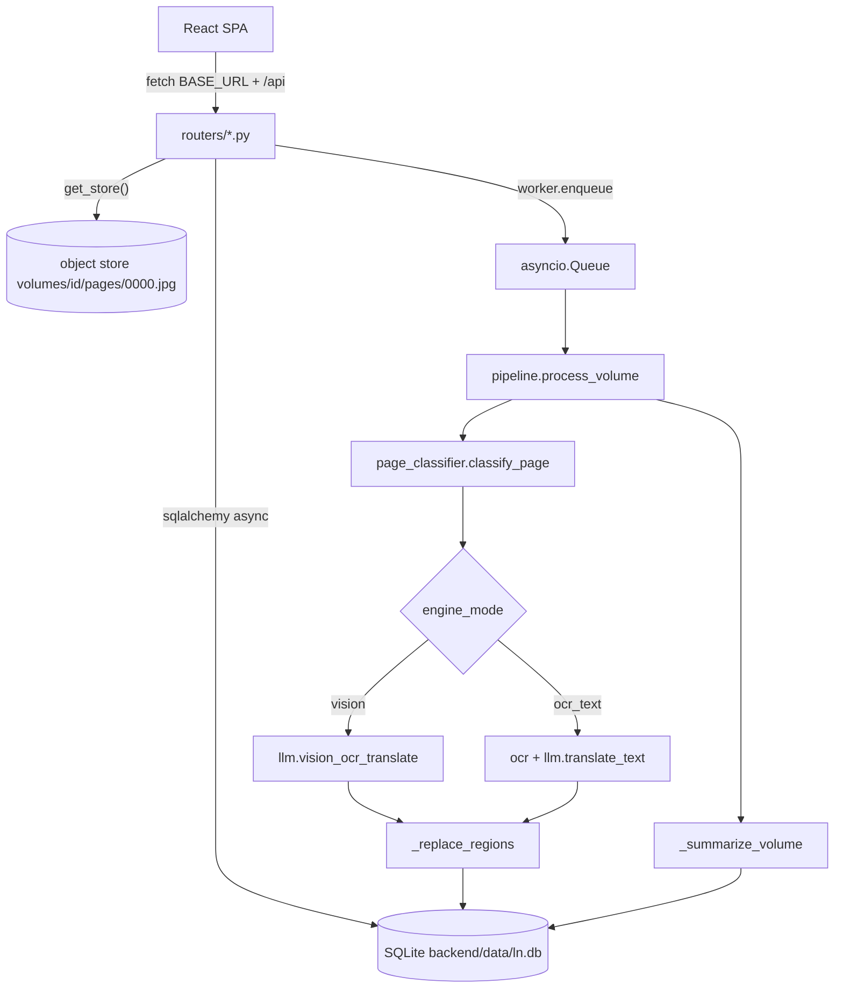
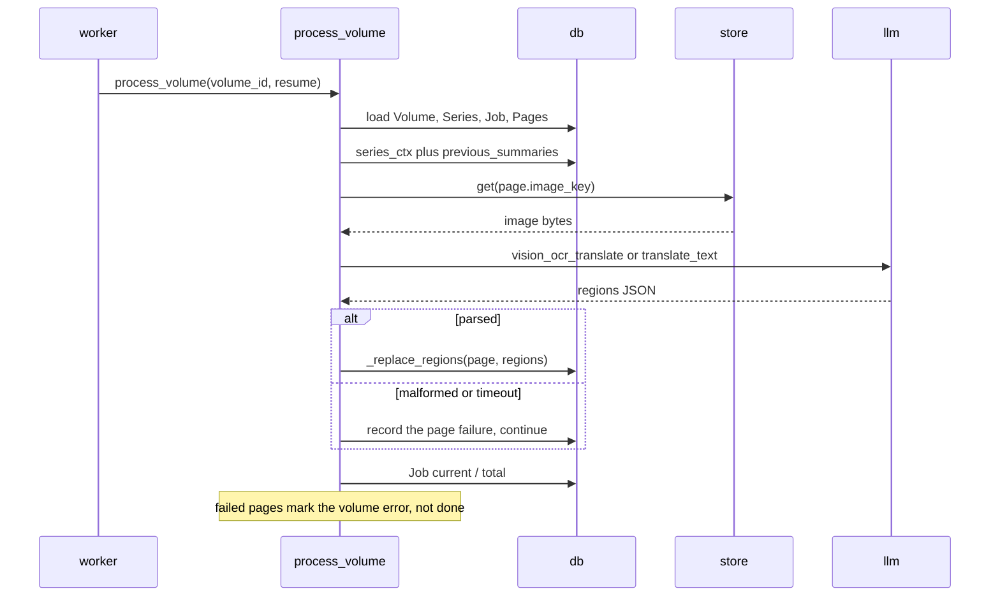
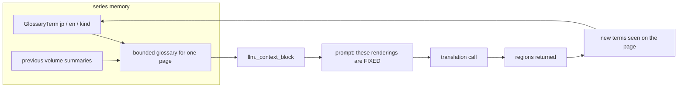

# Onboarding

Where to start reading for each area of the code, the dev loop, and the mistakes
that have already cost an afternoon.

## Mental model

```
series ──< volumes ──< pages ──< regions
```

- **Series** - the unit of work and of memory: `title`, `author`, `genres`,
  `source_language` / `detected_language` / `target_language`, `GlossaryTerm`.
- **Volume** - one book. `kind` is `scans` or `text`, `engine_mode` is `vision`
  or `ocr_text`, a `Job` row holds progress, `VolumeStatus` is `uploaded` /
  `queued` / `processing` / `paused` / `done` / `error`.
- **Page** - one image (`image_key` set) or one text chapter (`image_key` empty,
  `chapter_title` set); `index` orders it inside the volume.
- **Region** - one translated block: `order`, `x`/`y`/`width`/`height` as
  percentages, `japanese_text`, `english_text`, `confidence`.

Regions are the atom: reader, PDF re-layout and page diffing read regions, never a
string. Nothing writes the bbox columns yet, so the reader is a text panel, not an
overlay - see [ROADMAP.md](ROADMAP.md#open).

## What runs where

| piece | where |
|---|---|
| FastAPI app | `backend/main.py`, `uvicorn main:app` from `backend/`, port 8077 |
| HTTP surface | `backend/routers/*.py`, every router mounted under `URL_PREFIX` |
| object store | `backend/storage_backend/` (`LocalObjectStore`), files in `backend/storage/` |
| database | SQLite at `backend/data/ln.db` by default (`DATABASE_URL`) |
| frontend | `frontend/src/`, React 19 + Vite + shadcn/ui, built to `frontend/dist/` |
| serving | FastAPI serves the built SPA: `/assets` mount plus a catch-all |
| process | systemd unit named after the deploy target (`tome`), code in `/srv/tome/` |

`main.py` lifespan, in order: `init_db()`, `provider.load_from_db()` (UI settings
override `.env`), `start_worker()` (pauses jobs orphaned by a restart), `recover_agent_orphans()`.

**Subpath deployment.** To serve under a subpath such as `/tome/`, both knobs
must agree: `VITE_BASE=/tome/` at build time (Vite `base`; every
URL in `lib/api.ts` derives from `import.meta.env.BASE_URL`) and
`URL_PREFIX=/tome` at runtime (routers, `/api/health`, the `/assets` mount, the
SPA fallback, `store.url()`). `deploy.yml` builds with
`VITE_BASE=/${{ inputs.target }}/`, rsyncs `backend/` and `frontend/dist/` to
`/srv/<target>/`, then runs `systemctl restart <target>`. `URL_PREFIX` lives in
the box's `.env` or the unit environment, neither in the repo.

### Request and pipeline path



### One page's life



## Areas of the code

### Memory: the series graph

`backend/services/memory.py`, the `memory_*` tables in `backend/db/models.py`,
and `backend/tests/test_memory.py`. How it works: [GRAPH-MEMORY.md](GRAPH-MEMORY.md);
why: [MEMORY.md](MEMORY.md).

Start here:

1. `backend/db/models.py` - `GlossaryTerm` (`series_id`, `jp`, `en`, `kind`) and the three `memory_*` tables.
2. `pipeline._glossary_list(series)` - how the glossary becomes a prompt list.
3. `pipeline._merge_new_terms(session, series, new_terms)` - the write path, which hands the `memory` object to `memory.record_extraction`.
4. `memory.build_context(...)`, `pipeline._previous_summaries(...)` and `llm._context_block(...)` - the cross-volume context, and where it renders.

### Translation path and provider

`backend/services/llm.py`, `pipeline.py`, `worker.py`, `provider.py`, `ocr.py`, `page_classifier.py`.

Start here:

1. `worker.enqueue` -> `worker._run` -> `pipeline.process_volume`: the only way into translation.
2. `pipeline.process_volume` - classify loop, then `_run_vision`, `_run_ocr_text` or `_run_text_volume` by `engine_mode` and `kind`.
3. `pipeline._replace_regions(session, page, regions)` - model output becomes `Region` rows here; bbox mapping goes here too.
4. `llm._chat`, `_strip_fences`, `_context_block`, then `translate_text`, `vision_ocr_translate`, `ocr_page_vision`.
5. `pipeline._check_cancel` / `_cancel_requested` - cancel is checked between pages, never inside a request.

### Frontend

`frontend/src/`.

Start here:

1. `frontend/src/lib/api.ts` - `BASE` comes from `import.meta.env.BASE_URL`; `createProgressStream` and `createAgentStream` are the SSE feeds and both need the subpath.
2. `frontend/src/types.ts` - mirrors `backend/models/api.py`; change both.
3. `frontend/src/components/Reader.tsx`, `PageView.tsx` - the region renderer; overlay and "why this translation" belong here.
4. `frontend/src/components/SeriesDetail.tsx`, `ProcessingPanel.tsx`, `hooks/useProcessing.ts` - volume state and progress.
5. `frontend/src/components/ui/` - generated shadcn primitives, do not edit.

### Repository, CI and releases

`.github/workflows/`, `README.md`, `CONTRIBUTING.md`, `docs/`, `assets/`.

Start here: `.github/workflows/ci.yml` - backend on 3.11 and 3.12, ruff
`E9,F63,F7,F82`, pytest, frontend lint plus a real build with `VITE_BASE=/tome/`,
and a guard against committing a database, `.env`, `node_modules` or `dist`. Then
`.github/workflows/release.yml` (a `v*` tag runs CI and publishes a release from
CHANGELOG.md; the steps are in [CONTRIBUTING.md](../CONTRIBUTING.md#releasing)) and
`.github/workflows/deploy.yml` (manual, see [DEPLOYMENT.md](DEPLOYMENT.md)).

## Dev loop

```bash
cp .env.example .env
python -m venv venv && ./venv/bin/pip install -r backend/requirements.txt
cd frontend && npm install
```

Backend, from `backend/` so `config.py` resolves the project root:
`cd backend && ../venv/bin/uvicorn main:app --reload --port 8077`

Frontend: `cd frontend && npm run dev` - Vite on :5173, proxying `/api` and `/files`
to `VITE_API_TARGET` (default :8000; export :8077 to match the backend above).

Tests, the same commands CI runs:

```bash
cd backend && python -m pytest tests -q     # api contract, ingest, language, metadata
ruff check backend --select E9,F63,F7,F82   # from the repo root
cd frontend && npm run lint && npm run build
```

`torch`, `torchvision` and `manga-ocr` are the ~2 GB local-OCR stack, imported
lazily; CI strips them and the vision path runs without them.

State sits in two gitignored places: the database at `backend/data/ln.db`
(path-normalised by `config.py`, tables by `init_db()` on boot) and the object
store at `backend/storage/` (`LOCAL_STORAGE_DIR`); ingest staging is
`ingest.staging_path(upload_id)`. Deleting `ln.db` empties the library; deleting
`backend/storage/` leaves rows pointing at objects that are gone.

### How the glossary constrains translation



A name fixed on page 1 is still that name on page 400; what page 400 adds is available to 401.

## Traps

1. **One backend process per SQLite file.** Two uvicorn processes on `backend/data/ln.db` give `database is locked`, and the symptom is a delete button that silently does nothing. Look for a stray `--reload` child or a second service before debugging the handler.
2. **Never rename a storage key.** `volumes/<volume_id>/pages/0000.jpg` (`ingest.extract_group_to_volume`, `routers/volumes.create_volume`) is the only pointer a row has to its bytes. Reshape it and every existing page 404s while the rows still look healthy: add the new shape alongside the old, migrate rows, then retire the old one.
3. **One bad page must not kill a volume.** `process_volume` isolates per page, counts failures, and marks the volume `error` with a count instead of `done`. Any new stage keeps that: catch per page, record, continue, let `resume=True` retry only what failed. Malformed model output is a page failure, not a volume failure.
4. **`VITE_BASE` and `URL_PREFIX` must match the mount point.** One without the other gives a blank page or 404s on every asset: `/tome/` for the build (trailing slash), `/tome` for the runtime (none). `frontend/.env.production` sets `/`, so a bare local `npm run build` emits assets for the root; export `VITE_BASE` when building for a subpath.
5. **Do not block the event loop.** `time.sleep`, synchronous HTTP, PIL work or `open()` on a page inside a request or a worker task stalls everything else and looks like a hang. Use `asyncio.to_thread`, as `process_volume` does for `store.get`.

Conventions: [CONTRIBUTING.md](../CONTRIBUTING.md). Ordered work: [ROADMAP.md](ROADMAP.md).
